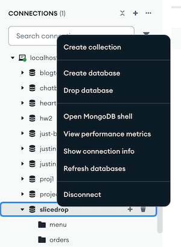

# HW4 — SliceDrop: A Client for Your Server

**Due:** See Canvas

**Covers:** Weeks 7–8 (connecting a client, CORS, real-time updates with sockets)

Two projects, side by side:

| | |
|---|---|
| `server/` | The Express + MongoDB server — your HW3 solution, plus HW4's work |
| `client/` | A React front end (Vite). It runs on mock data until you connect it |

HW4 has two halves. On the server, you finish what the lectures covered:
checking tokens in one place, CORS, and sockets that tell browsers when
something changes. On the client, you replace its mock data with real
requests to your server, so the whole app runs on your API.

## Setup

Each project has its own `package.json`, its own `npm install`, and its own
`.env`. Every `npm` command runs from inside `server/` or `client/`, never
from the repo root.

```bash
cd server
npm install
cp .env.example .env    # then set JWT_SECRET
npm run dev             # http://localhost:3000

cd ../client
npm install
cp .env.example .env
npm run dev             # http://localhost:5173
```

The client works on its own out of the box, on mock data: every name ends in "(mock)".
It only needs the server once you start connecting it.

Ran the server for HW3 already? Your database has HW3's menu, and the
server only seeds an empty one. HW4's menu knows which toppings each pizza
comes with, so drop the old database once and restart the server to reseed it:

```bash
mongosh slicedrop --eval "db.dropDatabase()"
```

Or use Compass: right click on the slicedrop db and select "Drop database"



Note that you will need to restart the server and re-login any clients after you wipe the DB.

Logins (you can also sign up). The mock data has them, and so does the
server's seed, so they keep working once the client is connected:

| Username | Password | Role |
|---|---|---|
| `client` | `client-password` | customer |
| `staff` | `staff-password` | staff |

Mock data lives only in memory: a page reload brings back the mock users
and orders and forgets anyone you signed up (log out and back in if a
screen complains). Also, two tabs don't talk to each other--a customer order
in one tab won't show up in a staff tab, no matter how many times you refresh.

## What you'll do

Every task is a `TODO:` comment in the code, with what it needs. Work in
this order: each step builds on the one before.

### Part 1 — the server

1. **`verifyToken`** — `server/src/services/auth-service.ts`. Start here
   (see "Server tests" below for why).
2. **`getClientOrigin`** — `server/src/config.ts`, then **CORS** —
   `server/src/app.ts`. The browser won't let the client read your
   server's answers until this is done.
3. **Sockets** (week 8):
   - `initSockets` — `server/src/sockets/sockets.ts`
   - `server/src/index.ts` — one HTTP server for Express and sockets
   - `orderCreated`, `orderUpdated`, `menuUpdated` —
     `server/src/sockets/notifier.ts`, **and calling each one** where the
     change is saved. The top of `notifier.ts` names the functions to look
     in; the call sites have no TODO comments — finding them is part of
     the work.

### Part 2 — the client

Everything is in `client/src/api/`. Each function uses mock data now; its
TODO says "replace the mock with a request" and names the route. Replace
it with a request to your server through `apiFetch`.

4. **`apiFetch`** — `client.ts`. Every other function depends on it.
5. **`menu.ts`** — `getMenu`, `getMenuItem`. Run both projects: the menu
   loses its "(mock)" names.
6. **`auth.ts`** — `login`, `register`.
7. **`orders.ts`** and **`users.ts`** — `placeOrder`, `getOrders`,
   `cancelOrder`, `getPoints`.
8. **Staff** — `updateOrderStatus` (`orders.ts`); `createMenuItem`,
   `updateMenuItem`, `deleteMenuItem` (`menu.ts`).
9. **`socket.ts`** — `subscribe`, `reconnectSocket` (week 8). The screens
   already subscribe; once these work, they update by themselves.

The mocks live with the tests, in `client/src/api/__tests__/mocks/`:
`mock-data.ts` (the menu, users and orders) and `mock-server.ts` (the
server's rules, played in the browser). Each function imports them only
until its TODO is done; when you're finished, nothing in `src/api/` should.
Leave the files there — the tests use the mock data as the fake server's
replies.

## Don't change

- `client/src/components/` — the screens. All the data they need comes from
  `src/api/` and the wiring is all there already.
- Anything marked `GIVEN:`, and every test.

## Seeing it work

When it's all done, run both projects. Log in as `staff` in one tab and as `client` in another
(each tab keeps its own login). Place an order as `client`: it shows up in
the staff tab's Orders without a reload. Move it along as staff: the
client's My orders follows. Change the menu as staff: every tab's menu
follows, logged in or not.

## Server tests: start with `verifyToken`

When you first run `npm test` in `server/`, a lot of tests fail — most of
HW3's included. That's expected. Every route that needs a token checks it
with `verifyToken` (`server/src/services/auth-service.ts`), which is a TODO,
so until you write it those routes answer 500 and their tests fail (look
for `TODO: verifyToken is not written yet` in the output).

Start there. Once `verifyToken` works, the HW3 tests pass again, and what's
still failing is the rest of HW4.

## Client tests

`npm test` in `client/` checks every function in `client/src/api/` — the
address, method, body and token each one sends, and what it gives back.
The tests fake the server, so nothing needs to be running. They all fail
until you replace the mocks with real requests (all but one: an
empty `reconnectSocket` already does nothing when no screen has
subscribed).

## Grading

Total Points: 120

- Autograder: 120 — 10 each for passing `npm run typecheck` in `server/`
  and in `client/`, then:
  - **Server:** 15 for `verify-token`, `config` and `cors` together; 20 for
    `sockets`; 15 for HW3's suites with the new toppings tests (`access`,
    `auth`, `errors`, `menu`, `orders`, `users`, and the two service unit
    tests) together. Those passed at the end of HW3 and mostly pass again
    once `verifyToken` works, which is why they carry less.
  - **Client:** 10 for `client` (`apiFetch`); 30 for `menu`, `auth`,
    `orders` and `users` together; 10 for `socket`.

  Partial credit within each group is proportional to the tests you pass.

The autograder runs the tests as they ship, in `server/` and in `client/`.
Behavior only — styles and layout aren't graded.
