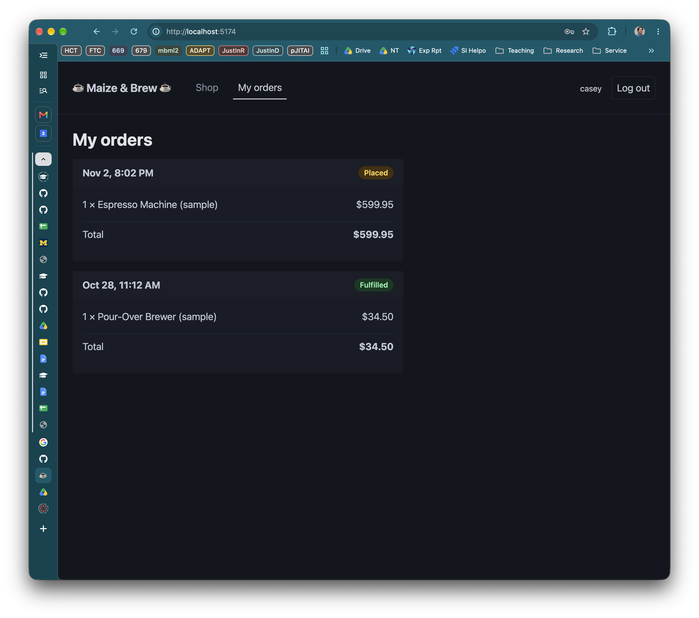
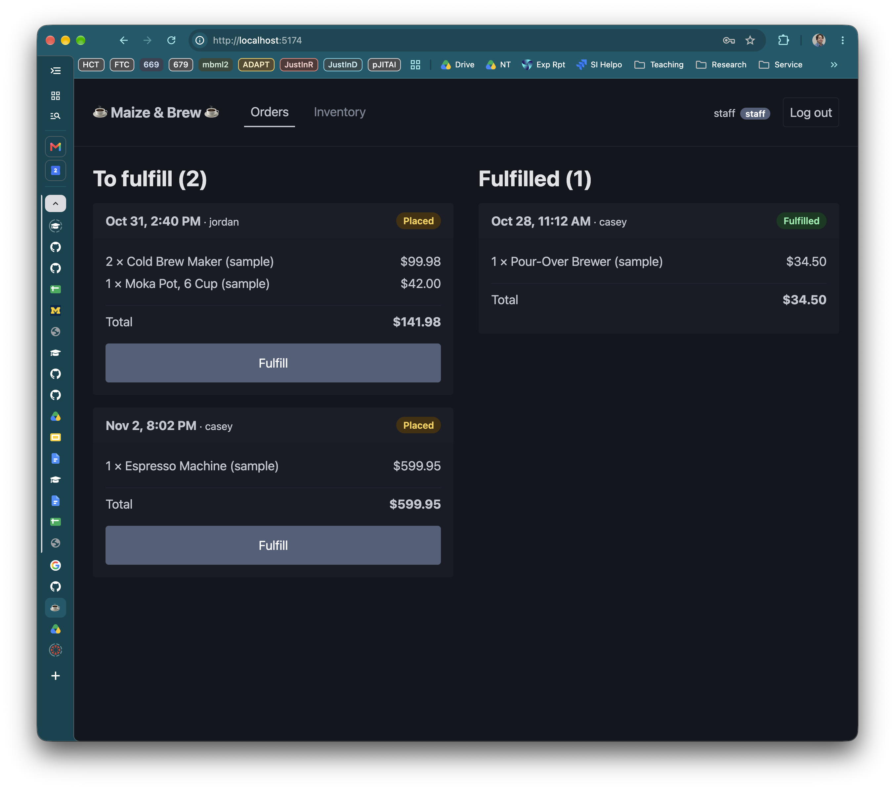
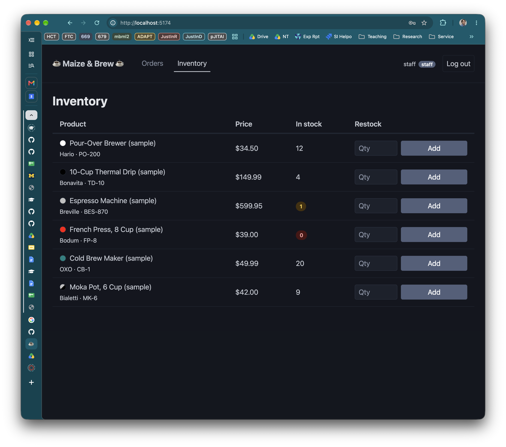
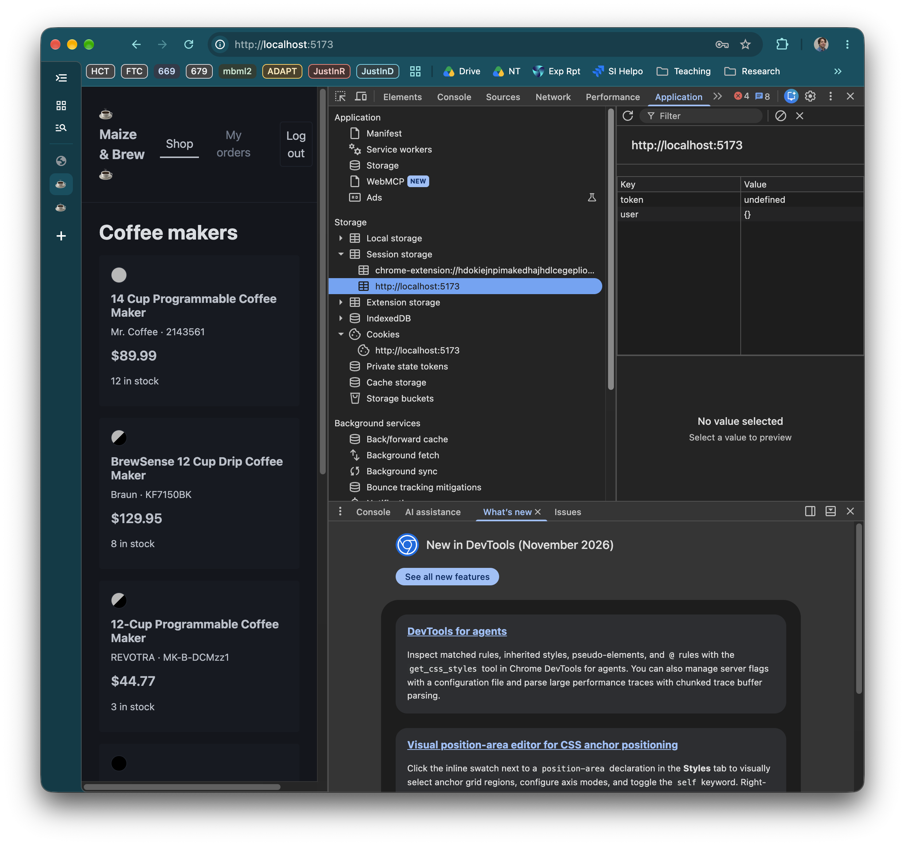
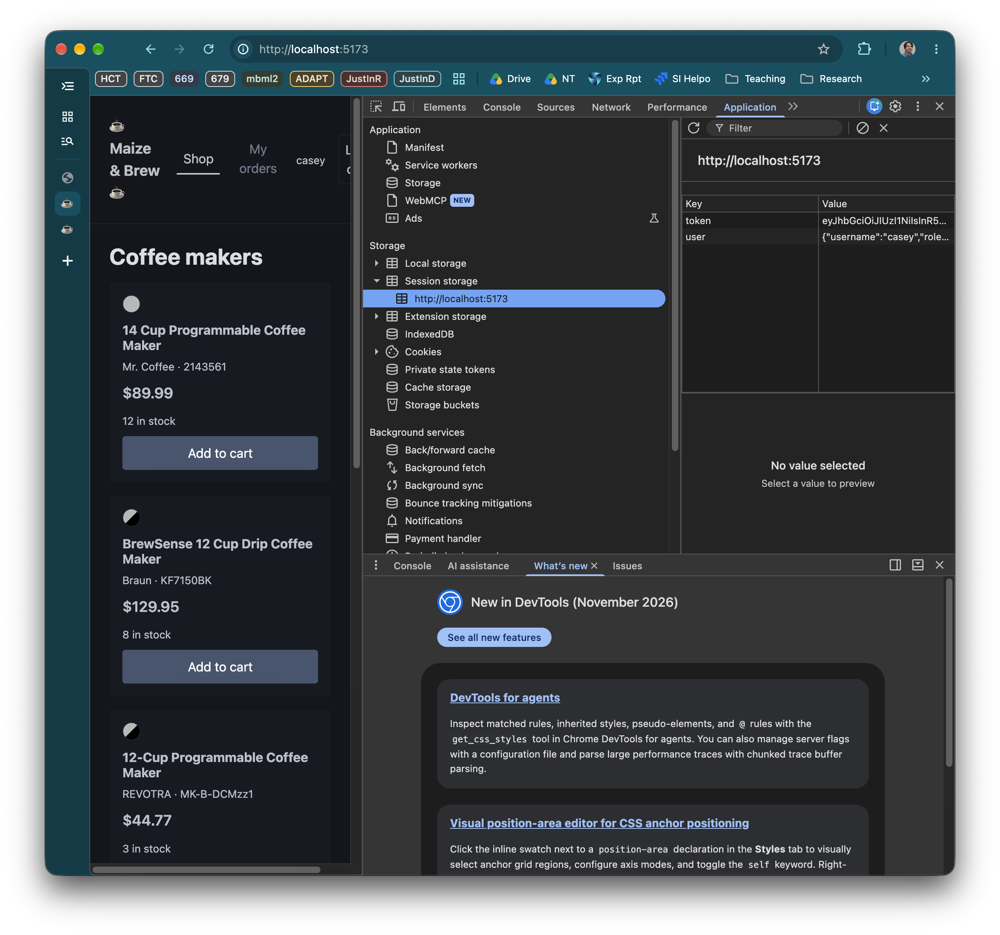

# Week 07 · Connecting a Client

We've spent the whole semester building backends and testing them using various tools like Postman and supertest, and inspecting the data they manage using tools like Compass. At no point has anything we've done looked anything like an app that you have ever used or would ever dream of putting in the hands of your users. Today, that will change. We'll look at what it takes to hook our backend API up to a somewhat plausible frontend.

## This week's goals

- Look at one way to build a React front end so that the interaction with the backend is contained to one part of the code
- Make requests from the client app, running in the browser with `fetch`, and handle what comes back
- Understand **Cross-Origin Resource Sharing (CORS)**, and how to configure your client and server to talk to each other with CORS in mind
- Log in from the browser and send the token with every request

## Clone the Starter

Accept the [Classroom 50 Assignment](https://classroom50.org/SI679-Classroom-F26/si-679-f-26/assignments/week07-nyt/accept?k=mjt5rszh). Clone it to your machine and open it in your editor.

The starter has **two projects** this week, side by side:

```text
week07-nyt-starter/
├── server/    the Express server, picked up from last week, plus a bit more
└── client/    a React front end, new this week
```

Each has its own `package.json`, and each needs its own install and its own
`.env`:

```bash
cd server
npm install
cp .env.example .env
cd ../client
npm install
cp .env.example .env
```

Then in `server/.env`, replace `JWT_SECRET`'s placeholder with a secret of
your own, as last week.

### Three terminals

From now on, running the app takes **three terminals**, each running one
thing. Let's get them going now even though you won't need the first two for a little while.

**1. MongoDB**, as usual (you probably don't need `mkdir` again, but the
folder given to `--dbpath` does need to exist):

```shell
# macOS / Linux
mkdir -p ~/data/mdata
mongod --dbpath ~/data/mdata
```

```shell
# Windows
mkdir c:\data\mdata
mongod --dbpath c:\data\mdata
```

**2. The server.** This week uses a new database, `week7`, so fill it first.
`npm run seed` adds a staff user, a customer and six products:

```shell
cd server
npm run seed
npm run dev
```

**3. The client:**

```shell
cd client
npm run dev
```

Vite prints a local address. Open `http://localhost:5173` in your browser.

::: tip Restart after editing `.env`
Both projects read `.env` only when `npm run dev` starts. If you change
either `.env`, stop that `npm run dev` (Ctrl-C) and start it again. Not now,
but if it comes up later...
:::

## A tour of the client

This is a backend course, so we won't dwell much on the client here. There are a few things worth understanding about how it's set up because you may wish to use these patterns in your own projects (for example, your final project). You'll be given a similarly fleshed-out client in HW4--both today and in HW4 you will only be asked to touch code in the `src/api` folder. You should NOT need to touch any components or `.tsx` files of any kind.

### Run it on sample data

The client starts in a working state, using in-memory sample data. Once we get oriented with both the client and server code at a high level, we will work on replacing the sample data with real data from the backend. You've done this kind of thing before.

With the client running (terminal #3 above--you don't need #1 or #2 just yet), click around:

- Logged out, you can browse the catalog.


- Log in as **`casey` / `casey-password`** (specified in `src/api/sample-data.ts`). Customers get a cart and can place orders, then see them under **My orders**. There's a "fulfilled" order already in My Orders from the sample data. Add another order and see this screen fill up.



- Log out and log in as **`staff` / `staff-password`**. Staff get the
  **Orders** queue (starts with two, plus you should see any that casey just placed), where they fulfill orders...



...and **Inventory**, where they restock products.



Play around with this for a minute. Try:

- Fulfill casey's order, then log in as casey to see the change in My Orders
- Place an order that depletes all the stock for an item. See it marked "Sold Out" in the Shop.
- Place an order that would make a product's quantity go negative (you'll need to directly edit the number in the cart--the arrows won't let you get there). See the error message in the UI.
- Log in as staff again and restock. See the change in inventory and, as casey, in the shop.

You'll note that every product name ends in "(sample)". That's on purpose: none of this is
coming from our server yet, and the "(sample)" makes it easy to see that.

### How the client is organized

```text
client/src/
├── main.tsx             starts React; loads the CSS
├── App.tsx              who's logged in, and which screen to show
├── types.ts             Product, Order, User — the same shapes the server sends
├── components/          the screens: Shop, Cart, MyOrders, OrderQueue, Inventory, …
├── api/                 ← everything that will talk to the server
│   ├── products.ts      getProducts, restockProduct
│   ├── orders.ts        placeOrder, getOrders, fulfillOrder
│   ├── auth.ts          login, register, logout
│   ├── session.ts       remembers the token and the user
│   └── sample-data.ts   the in-memory stand-in for the server
├── format.ts            prices and dates
└── styles.css           layout
```

You're free to study the client code in more depth later--for now you'll just have to trust that it works. As you'll see, when you change the code in `api/` the client will keep working, it'll just be using different data.

:::tip Keeping types consistent
One thing to note is that we have a parallel set of types in the client that
is more or less identical to the set in the server (the server has a few additional types that it only uses internally). Keeping these in sync can be a headache and a significant source of errors as an app gets more complex. There are solutions to this that are beyond the scope of what we can cover in this class. [OpenAPI](https://www.openapis.org/) and the ecosystem of packages and tools around that are a great place to start when you find yourself swimming in types you need to keep consistent.
:::

### `App`: who's logged in, and which screen

`client/src/App.tsx` keeps two pieces of state: who is logged in, and which
screen we're looking at.

::: code-group
<<< ../../../code/week07-client/week07-starter/client/src/App.tsx#state{tsx} [client/src/App.tsx]
:::

We create two state variables along with their setters via `useState` -- one for the currently logged-in user and another for the view that should be shown ('login' | 'shop' | etc.). Recall that callling a state updater like `setUser` or `setView` changes the value of that variable **and re-renders the component** with it. These state updaters are the key to how changes to data can force updates to the UI.

`user` starts out as whatever `getCurrentUser()` remembers (this is stored in the `session.ts` and accessed via `auth.ts`), which allows a logged in user to survive a page reload. Logging in and out each change both pieces of state at once: who you are, and the screen you start with.

Further down in `App.tsx`, we render the header and exactly one screen:

::: code-group
<<< ../../../code/week07-client/week07-starter/client/src/App.tsx#render{tsx} [client/src/App.tsx]
:::

:::tip React refreshers
In case it looks unfamiliar, `{view === 'shop' && <Shop … />}` is React's idiom for "show this only if…":
when the left side is false, React renders nothing. There are five possibilities for what `view` can `===` and only one can be true at once. That provides a simple version of navigation that lets us avoid React Router and heavyweight state management solutions like Redux--good enough for a small app and good enough for now.

The bits inside the tags (`user={user}`, `onLogout={handleLogout}`) are
**props**: how a parent passes data down to a child, and functions the child
can call to tell the parent something happened.
:::

### One screen, start to finish

Every screen is wired up to get its data the same way. **My orders** is the simplest, so
here is all of `client/src/components/MyOrders.tsx`:

::: code-group
<<< ../../../code/week07-client/week07-starter/client/src/components/MyOrders.tsx{tsx:line-numbers} [client/src/components/MyOrders.tsx]
:::

Four parts, top to bottom:

1. **Three pieces of state (lines 7–9):** the data, whether it's still
   loading, and an error message, if any. Every screen that loads something
   has these three.
2. **A loader (lines 11–20)** that calls the API function and puts the result
   in state. If the call throws, it stores the error's **message** instead.
   Either way, loading is over.
3. **`useEffect(…, [])` (lines 22–24)** runs `loadOrders` once, right after
   the screen first appears. The empty array means "once"; anything listed in
   it would re-run the effect when it changed. (Why not call `loadOrders()`
   directly in the component body? The body runs on *every* render, and
   setting state causes a render, so that would loop forever.)
4. **The JSX (lines 31–43)** describes what to show for each state: a
   spinner while loading, the error if there is one, a message if there are no
   orders, and otherwise one `OrderCard` per order.

Shop, the staff Orders queue and Inventory all follow this pattern. They just
have more on screen.

::: info Why `key={order.id}`?
When React renders a list, it needs a stable way to tell the items apart, so
that when the list changes it updates the right ones. A database id (or a sample one as we will have to start) is the
perfect key. Anything works as long as it's unique and lets you connect the rendered list item to the underlying data.
:::

### The API layer

That's all we'll say about the UI, at least for now. So where does `getOrders()` get its orders? From `client/src/api/orders.ts`:

::: code-group
<<< ../../../code/week07-client/week07-starter/client/src/api/orders.ts#get-orders{ts} [client/src/api/orders.ts]
:::

It's pretending to be a server:

- It's **`async`** and waits a moment (`await delay()`, which is a fun little function in `api/sample-data.ts` that inserts a 300ms delay, like a real request does), so the loading state shows up.
- It looks at `user.role` to decide who sees what, just like the server does: staff get every order, customers only their own.
- It reports problems the way the components expect: by **throwing an
  `Error`** with a message the server would send. (`'No token'` here is the very message our `requireJwt` sends back.)

From the component's side, all that matters is the signature:
`getOrders(): Promise<Order[]>`. What's behind that return value could be an array in memory
or a request to a server on the other side of the world. **Today we change the insides of `getOrders()` and other `api` functions, and leave the signature alone**, and that's why no component has to change.

### Remembering who's logged in

Another file in `src/api/` that merits an introduction is
`client/src/api/session.ts`. It keeps the token and the logged-in user between requests:

::: code-group
<<< ../../../code/week07-client/week07-starter/client/src/api/session.ts{ts} [client/src/api/session.ts]
:::

The token goes in **`sessionStorage`**, the browser's small per-tab
key-value store. It survives a page reload but not closing the tab. We're using it today instead of its sibling `localStorage` for one reason: `localStorage` is shared by
every tab of the same site, so logging in as staff in a second tab would log
your first tab in as staff too. With `sessionStorage`, each tab has its own
login state. For a real app, you'd expect only one user to be logged in per browser, and for their state to be shared across tabs so you'd probably want `localStorage`, but `sessionStorage` will make testing a lot easier this week and next.

:::tip Beyond local/session storage
A lot of real apps don't even use `localStorasge` but will keep the token in a cookie that JavaScript can't read, which
has its own trade-offs that are beyond what we have time for today or this semester. Stashing information in the browser is a hearty topic on its own, as this is the site where a lot of security battles are fought so the landscape changes as new exploits are discovered. We're using `sessionStorage` so you can see what's going on but keep in mind that you will want to look into this in more depth before releasing something into the wild.
:::

### Summary: the client `api` folder

```text
 components  ──call──▶  src/api/*.ts  ──▶  sample-data.ts   (now)
                                      ──▶  our server       (by the end of today)
```

## A tour of the server

On the server side, we're working with the latest iteration of the api server we've been building over the last several weeks. It has fleshed-out routes from top to bottom for `/products`, `/users`, and `/auth`, which are now joined by the routes we'll need for `/orders` (which are basically what you built in HW2).

### What's new

```text
server/src/
├── models/order.ts              Order, OrderItem, OrderStatus ('placed' | 'fulfilled')
├── db/orders-repository.ts      insert, find, change status
├── services/orders-service.ts   placeOrder, listOrdersFor, fulfillOrder
├── controllers/orders-controller.ts
├── routes/orders-router.ts
```

There are also changes to the product stack to support depleting inventory (`takeStock`) and restocking (`addStock`), along with `scripts/seed.ts` (familiar, but now with a couple of seed orders) to set up the DB for demos and an expanded set of tests in `__tests__`.

The client only cares about the endpoints, though, and the relevant ones for today are:

| Who | Endpoint | Does |
|---|---|---|
| anyone | `GET /products` | the catalog |
| anyone | `POST /auth/register`, `POST /auth/login` | as last week |
| logged in | `GET /auth/me` | who this token belongs to |
| customer | `POST /orders` | place an order: a list of items, each a product id and a quantity |
| logged in | `GET /orders` | staff: every order; customer: just their own |
| staff | `PATCH /orders/:id/status` | fulfill an order: the new status, `fulfilled` |
| staff | `POST /products/:id/restock` | add to a product's stock: the amount to add |

Notice what an order **doesn't** include: who's placing it. The server takes
that from the token, just as week 6's ownership checks did. Anything a
client puts in a request body it could fake, so a customer can't order in
someone else's name.

The orders routes are in `server/src/routes/orders-router.ts`:

::: code-group
<<< ../../../code/week07-client/week07-starter/server/src/routes/orders-router.ts{ts} [server/src/routes/orders-router.ts]
:::

The same `requireJwt` / `requireRole` pattern as week 6 and HW3.

### Placing an order

The work happens in `placeOrder`, in `server/src/services/orders-service.ts`:

::: code-group
<<< ../../../code/week07-client/week07-starter/server/src/services/orders-service.ts#place{11-20,23-25 ts:line-numbers} [server/src/services/orders-service.ts]
:::

Two things worth noticing:

- **The client sends product ids and quantities, never prices.** The names and
  prices come from the database (line 12). It's the same idea as
  "the owner comes from the token": never trust the client with something it
  has a reason to lie about.
- **Everything is checked before anything changes** (lines 11–20). If any
  product is short on stock, the order stops with a `409` and a message the client can
  show, and no stock has been touched. That makes an order all or nothing.
  Only once every item checks out does the stock get depleted (lines 23–25).

`takeStock`, in `server/src/db/products-repository.ts`, does the subtracting:

::: code-group
<<< ../../../code/week07-client/week07-starter/server/src/db/products-repository.ts#stock{9 ts} [server/src/db/products-repository.ts]
:::

`updateOne` takes two arguments: a **filter** that says which document to
change (the product with this `_id`) and the **change** to make. You've seen
`$set` for changes; `$inc` adds a number to a field, and a negative number
subtracts. Restocking uses `$inc` too, in `addStock`, right below in the same file.

::: details Advanced: checking and changing in one step
Checking in the service and then changing in the repository leaves a small gap.
Say there's **one** left, and two customers press **Place order** at the same
moment:

1. Request A reads the product: 1 in stock. Enough.
2. Request B reads the product: still 1 in stock. Enough.
3. A takes 1. Stock is 0.
4. B takes 1. Stock is **−1**, and we've sold something we don't have. Oops.

This is a **race condition**: the answer depends on which request gets there
first. It's rare with a few users, and with enough of them it happens
sooner or later.

The fix is to let MongoDB check and change in a single step, by putting the
check **in the filter**:

```ts
const result = await getDb()
  .collection(PRODUCTS)
  .updateOne(
    { _id: new ObjectId(id), quantity: { $gte: quantity } },
    { $inc: { quantity: -quantity } }
  );
return result.modifiedCount === 1; // false: there wasn't enough
```

The filter now reads "the product with this id **whose `quantity` is at
least** what we're taking" (`$gte` is "greater than or equal"). If there isn't
enough, no document matches, nothing changes, and `modifiedCount` is `0`.
MongoDB guarantees that a single update to one document can't be interrupted
halfway, so in the race above only one of the two requests can match.

The catch is the multi-item order: if the second product comes up short, the
first one's stock has already been taken and has to be put back. That's why we
kept the simpler version here.
:::

### See it from the browser

With the server running (you now need both terminal #1 and #2 running, and need to have run the seed script as shown above), open `http://localhost:6790/products` in a
browser tab. There's the seeded catalog, as JSON: no "(sample)" anywhere.
Remember that this works; it's about to look like it doesn't.

## Connecting the client

### Where's the server?

The client finds the server through `client/.env`:

::: code-group

```sh [client/.env]
VITE_API_URL=http://localhost:6790
```

:::

In the client's code, that's `import.meta.env.VITE_API_URL`.
`import.meta.env` is Vite's way of handing `.env` values to code that runs
in the browser. Only names starting with `VITE_` are passed along. That's a
safety catch: everything sent to the browser is public, so a secret in
`client/.env` must never get a `VITE_` name.

### The first real request

Replace `getProducts()` in `client/src/api/products.ts` with a real request:

::: code-group

```ts [client/src/api/products.ts]
export const getProducts = async (): Promise<Product[]> => {
  const res = await fetch(`${import.meta.env.VITE_API_URL}/products`);
  return res.json();
};
```

:::

`fetch` is the browser's built-in way to make an HTTP request. It returns a
`Response`, and `.json()` reads its body as JSON. Both return promises, hence
the two `await`s.

Save, and look at the Shop. Nothing. Open DevTools (**Cmd-Option-I** /
**Ctrl-Shift-I**) and look at the **Console**:


The page itself shows the error too, in red: `Failed to fetch`. That's the
Shop component's `error` state doing its job.

### CORS

The same URL worked a minute ago when we typed it into the address bar. What
changed is **who's asking**: this time the request comes from JavaScript
running inside a web page.

An **origin** is the first part of a URL: its scheme, host and port.
`http://localhost:5173/anything` has the origin `http://localhost:5173`. Two
URLs share an origin only if all three parts match.

Two origins are involved here:

- **The page's origin**, `http://localhost:5173`: where the browser loaded
  the client's code from (Vite's dev server).
- **The server's origin**, `http://localhost:6790`: where that code is
  sending its request.

Same host, different port, so these are **different origins**, and the
request is **cross-origin**.

The browser remembers which origin every page came from, and it follows the
**same-origin policy**: code from one origin may *send* a request to another
origin, but the browser won't let that code *read the response* unless the
server explicitly says it trusts the page's origin. The server says so with a response
header:

```http
Access-Control-Allow-Origin: http://localhost:5173
```

This means: "pages from `http://localhost:5173` may read my responses." That's
**CORS** (Cross-Origin Resource Sharing): the server's way of opting in. The
**browser** does the checking; the server only states its policy.

One thing to note is who is being protected. It isn't our server: the request reached it,
and it answered normally. You can't see that answer in the browser (that's
the point), and the Network tab shows only the request, with **CORS error**, so you'll have to trust me (or, even better, look it up!)

The protection, in fact, is for **the person using the browser**. Without it, any page
they happen to visit could quietly call other sites with their cookies and
read the answers: their webmail, their bank. So the browser holds the
response back unless the server says it trusts the page's origin.

That's also why Postman and supertest never ran into this. They
aren't browsers, and they don't enforce it.

### Opting in

The [`cors`](https://www.npmjs.com/package/cors) package is Express
middleware that adds the CORS headers for us. It's already a dependency in
the server's `package.json`, so your `npm install` downloaded it, but no code
uses it yet. We'll import it and add it to the server's `app`.

First, we'll add a setting for which origin to trust. It's in `.env` already, as
`CLIENT_ORIGIN`, so add a getter at the bottom of `server/src/config.ts`:

::: code-group
<<< ../../../code/week07-client/week07-lecture/server/src/config.ts#client-origin{ts} [server/src/config.ts]
:::

Then, in `server/src/app.ts`, import `cors` and the getter (lines 2 and 8),
and add the middleware **before** the routes (line 12):

::: code-group
<<< ../../../code/week07-client/week07-lecture/server/src/app.ts{2,8,12 ts:line-numbers} [server/src/app.ts]
:::

`cors({ origin: … })` adds the `Access-Control-Allow-Origin` header to every
response, naming our client. We could write `cors()` with no options, which
allows *every* origin, but then any website could use our API from its
visitors' browsers. Ideally name the origin as precisely as possible, though sometimes you may want to run with this open in development--just don't forget to fix it before deployment or you kind of defeat the whole purpose. Also note that this needs to be in `.env` rather than code because you will *definitely* need to change this when you move from development on `localhost` to any kind of deployment.

Here's a pictorial representation of how CORS works in our current setup:


Save the changes to `app.ts` and reload the client: the Shop
shows the real catalog, and the "(sample)"s are gone.

Now log in as `staff` (still sample data, for now) and open **Inventory**:
it's real too. Both screens call `getProducts()`. **One function changed, and
every screen that uses it changed with it.**

### Logging in for real

Logging in needs more than `getProducts` did:

1. A `POST` to `/auth/login` with a **JSON body**, which means setting
   `Content-Type: application/json` and turning the body into a string
   with `JSON.stringify`.
2. Then a `GET /auth/me` **with the token** in an `Authorization: Bearer …`
   header, to find out the user's role. Note that we *could* read the role straight out of the token. The payload is only encoded, not encrypted, as you saw on jwt.io last week. But decoding it in the browser is fiddly, and the client can't verify the signature without the secret, so it would be trusting whatever it read. We already have a clean way to get the user from the server, `GET /auth/me`, so we'll trade an extra request for simpler code.

And every request after login will need the token too. Rather than write
that out every time, we'll put it in one helper, in a new file,
`client/src/api/client.ts`: the one place in the client that knows how to
talk to the server. It starts with an import and the server's address:

::: code-group
<<< ../../../code/week07-client/week07-lecture/client/src/api/client.ts#api-url{ts} [client/src/api/client.ts]
:::

Then, in the same file, a first version of the helper:

::: code-group

```ts [client/src/api/client.ts]
type Options = {
  method?: string;
  body?: unknown;
};

export const apiFetch = async (
  path: string,
  options: Options = {}
): Promise<any> => {
  const headers: Record<string, string> = {};

  // Sending JSON? Say so, so express.json() will read it.
  if (options.body !== undefined) {
    headers['Content-Type'] = 'application/json';
  }

  // Logged in? Grab the token from the session and add it to the header.
  const token = getToken();
  if (token) {
    headers['Authorization'] = `Bearer ${token}`;
  }

  const res = await fetch(`${API_URL}${path}`, {
    method: options.method ?? 'GET',
    headers,
    body: options.body === undefined ? undefined : JSON.stringify(options.body)
  });
  return res.json();
};
```

:::

Piece by piece:

- **`path` and `options`:** `apiFetch('/products')` for a plain GET, or
  `apiFetch('/auth/login', { method: 'POST', body: { … } })`.
- **`Content-Type`**, only when there's a body. Without it, `express.json()`
  on the server doesn't know the body is JSON and leaves `req.body` empty.
- **`Authorization`**, whenever we have a token it goes into the `Authorization` header, prefixed by `Bearer `.
- `apiFetch` returns `Promise<any>`. `any` buys simplicity here. Each caller says what
  type it really returns, as `getProducts` does with `Promise<Product[]>`.

Back in `client/src/api/products.ts`, `getProducts` becomes one line:

::: code-group
<<< ../../../code/week07-client/week07-lecture/client/src/api/products.ts#get-products{ts} [client/src/api/products.ts]
:::

and `login` in `client/src/api/auth.ts` becomes:

::: code-group
<<< ../../../code/week07-client/week07-lecture/client/src/api/auth.ts#login{ts} [client/src/api/auth.ts]
:::

(Add `import { apiFetch } from './client.ts';` at the top of both files.)

Log in as **`casey` / `casey-password`**. It works: you're casey, with real
products in the Shop. Log out.

### A wrong password logs you in as nobody

Now log in as **`casey`** with a **wrong** password.

You're in. The header shows the customer tabs and **Log out**, but no
username. Who are you?


Look at the network tab in Developer Tools, particularly the two 401s.

- **Network tab:** `POST /auth/login` came back **`401`**, and so did
  `GET /auth/me`. The server refused both times.
- **Application → Session storage:** the token is the text `"undefined"`,
  and the user is `{}`.



Shouldn't someone have thrown an error? Yes, but it's not automatic.

Let's look at `login()` again:

::: code-group
<<< ../../../code/week07-client/week07-lecture/client/src/api/auth.ts#login{ts} [client/src/api/auth.ts]
:::

1. The server answered the login with `401` and
   `{ "error": "Wrong username or password" }`. This came from the auth middleware
   on the server.
2. **`fetch` didn't throw.** As far as `fetch` is concerned, *any* response is
   a success; it only throws when no response comes back at all. So
   `res.json()` read the error body, and `apiFetch` returned it as if it were
   good news. Nothing else in `apiFetch()` second-guesses `fetch()`, so nothing is thrown and everything looks fine to the caller (`login()`).
3. `login` looked for a `token` in it, found `undefined`, and saved that. Notably it
   did NOT check the status of the response.
4. `GET /auth/me` sent `Authorization: Bearer undefined`. Another `401`, also
   returned as if it were good news.
5. `login` built a user out of that error, with no username and no role, and
   the app logged it in.

The server said no twice, and our client didn't listen. Click **Log out** to
clear the bad session.

### Checking `res.ok`

Every response has a `res.ok`: `true` when the status is 200–299, and `false`
otherwise. In `client/src/api/client.ts`, replace the last line of `apiFetch`
(`return res.json();`) with the highlighted lines:

::: code-group
<<< ../../../code/week07-client/week07-lecture/client/src/api/client.ts#api-fetch{24-33 ts:line-numbers} [client/src/api/client.ts]
:::

- **Lines 30–32:** if the status isn't a success, throw an `Error`. Our server
  answers every error as `{ "error": "…" }`, so the server's own message
  becomes the error's message. That's what the components catch and show in
  red.
- **Line 26:** not every response has a JSON body. Mistype a path and Express
  answers `404` with an HTML page, and `res.json()` would fail with a
  baffling `Unexpected token '<'`. The `.catch(() => ({}))` falls back to an
  empty object, so the error message becomes the status instead (line 31).

:::tip `await` and `.catch()`
`.catch()` will fire if and only if `res.json()` throws an error, and `{}` will be what is returned from the `await`. Otherwise the result of `res.json()` is returned.
:::

Try the wrong password again. This time you stay logged out, and the login
form shows the server's message: **Wrong username or password**.

Because every request goes through `apiFetch`, that one fix covers all of
them: a `409` when stock runs out, a `403` for the wrong role, a `401` when a
token expires.

### When there's no answer at all

The other way a request can fail is that **no response comes back**. Stop the
server (Ctrl-C in its terminal) and reload the client. This time `fetch`
itself throws, and the Shop shows `Failed to fetch`. So that's working fine (though a more helpful error message might be warranted). Start the server again.

### Try it

- Log in properly. In DevTools, open **Application → Session storage →
  `http://localhost:5173`**: there's the token.
- Open a **second tab** on the client. It's logged out: its own
  `sessionStorage`. Log in as `staff` there. Both tabs stay logged in as
  different people.



Now, as casey, add something to the cart and **Place order**. You get
`Product not found`. The cart holds *real* products now, but `placeOrder`
is still looking them up in the sample data. Which is your first job in the Now You Try. We'll get to that after a few notes and announcements.

## Things we didn't handle

This client works, but it cuts corners a real one probably wouldn't. None of these
matter for today, but they're worth thinking about for your final project and beyond:

- **Expired tokens.** Our tokens last 3 hours, so they outlast our class
  session. When one does expire, every request fails with `Invalid or expired
  token` while the app still looks logged in. Real apps either send the user
  back to the login screen when the server answers `401`, or use short-lived
  tokens plus a *refresh token* to get new ones without the user noticing.
- **Hiding a button isn't security.** Customers never see a Fulfill button,
  but what actually stops them fulfilling orders is `requireRole` on the
  server. Anyone can call your API without your client: Postman, `curl`, the
  browser console. Every rule has to live on the server. The client just
  avoids offering things that will fail.
- **Screens don't update each other.** Place an order in one tab, and the
  staff tab won't show it until it reloads. We'll tackle that next week with web sockets.
- **Data goes stale.** The stock the Shop shows is whatever it was when the
  page loaded. If someone else buys the last one first, your order gets a
  `409`, and the server's check is what saves you. Web sockets will help with this also.
  (and the Advanced note under "Placing an order" covers the gap between checking and changing.)
- **Where the token lives.** `sessionStorage` is readable by any JavaScript
  on the page. Real apps often use a "HTTP Only" cookie that JavaScript can't read,
  which brings trade-offs of its own.
- **When the network fails.** If the server is down we show
  `Failed to fetch` and stop. Real apps say what's wrong in plainer words, and
  may retry.

## Announcements

- We enjoyed seeing you all for the midterm IPAs. I know it may have been less enjoyable for you :).
- HW2 and midterm grades out soon. As soon as I can find a minute!
- Only two lectures left: Web Sockets/real time updates and deployment! There are two unscripted class meetings that, by default, will be opportunities for you to talk with José and me about your final projects. We are open to other ideas as well (e.g., talk about AI? AMA?)
- Also one homework left: sockets and client integration.

## Now You Try

::: tip Lost? Catch up here
Copy these from the
[finished lecture code](https://github.com/SI679-public/SI679-public.github.io/tree/main/code/week07-client/week07-lecture)
into your project, replacing yours:
`client/src/api/client.ts`, `client/src/api/products.ts`,
`client/src/api/auth.ts`, `server/src/config.ts` and `server/src/app.ts`.
:::

Your job: **connect the rest of the client.** Five functions still use sample
data. Replace each one so that it makes the relevant request to the server, using
`apiFetch`. Don't change their signatures, and don't touch any components.

Take a break whenever you need one. Ask if you get stuck. If you finish and want to grab me
or José to discuss other things (like your final project), feel free!

### The customer side

**1. `register` in `client/src/api/auth.ts`:** `POST /auth/register` with the
username and password. The server answers `201` with the new user but no
token, so finish by logging in as them. (There's a function for that.)

**2. `getOrders` in `client/src/api/orders.ts`:** `GET /orders`. The server
already decides who sees what, using the token.

**3. `placeOrder` in `client/src/api/orders.ts`:** `POST /orders`. The server
expects a JSON body with the list of items in a field called `items`. Compare
that with what the client's `placeOrder` is given.

### The staff side

Log in as **`staff` / `staff-password`** to try these.

**4. `fulfillOrder` in `client/src/api/orders.ts`:** `PATCH /orders/:id/status`.
The order's id goes in the path, so build it with a template string:
`` `/orders/${id}/status` ``. The body has one field, `status`, set to
`'fulfilled'`.

**5. `restockProduct` in `client/src/api/products.ts`:** `POST
/products/:id/restock`, with the product's id in the path and the amount to
add in a field called `amount`.

### Tidying up

Once nothing in a file uses `sample-data.ts` any more, delete that import so
TypeScript doesn't complain about unused names. When no file imports it at
all, you can delete `sample-data.ts` itself.

### You're done when...

- You can create a new account, and you're logged in as it straight away.
- As that customer, you can place an order. It shows up in **My orders**,
  and in Compass in the `week7` database's `orders` collection, and the
  Shop's stock counts drop by what you ordered.
- Ordering more of something than is in stock shows the server's
  `Not enough … in stock` message in the cart, and nothing changes.
- As staff, you can fulfill that order. It moves to **Fulfilled**, and the
  customer sees **Fulfilled** in My orders (after switching tabs or
  reloading).
- As staff, restocking a product raises its count in **Inventory**, and in the
  Shop.
- Nothing imports `sample-data.ts`, and `npm run typecheck` passes in
  `client/`.

Once it all works, try it with two browser tabs, a customer in one and staff
in the other. Notice what you have to do to see each other's changes. That's
where we start next week.

Lecture code with Now You Try solutions can be found
[on GitHub](https://github.com/SI679-public/SI679-public.github.io/tree/main/code/week07-client/week07-nyt-solution).
