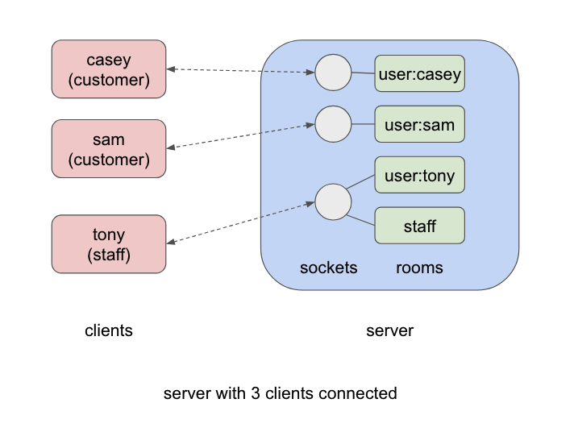
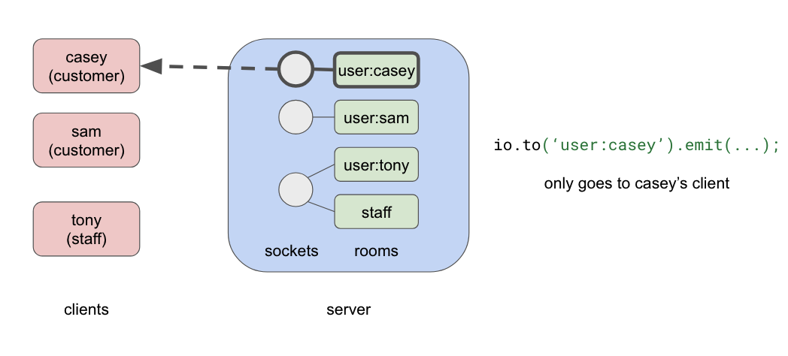
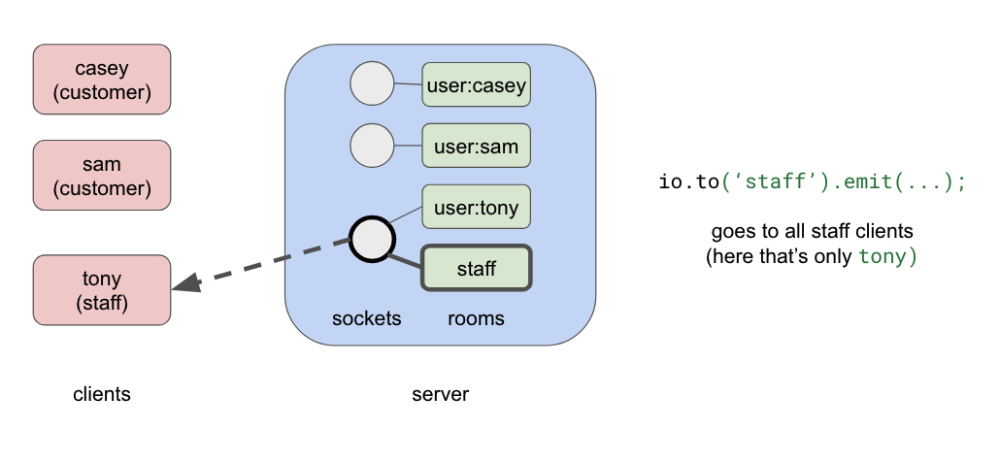
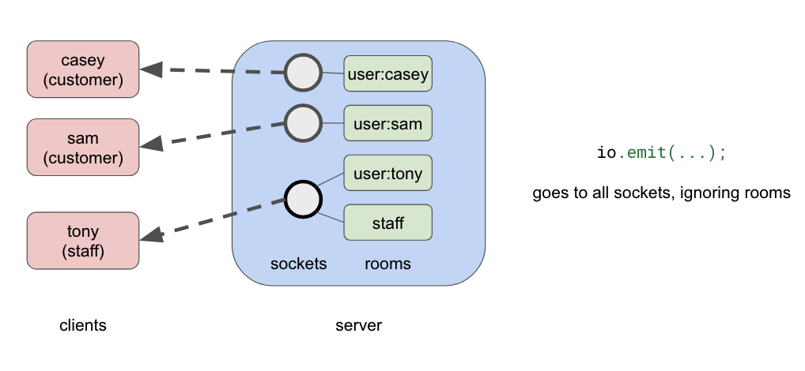
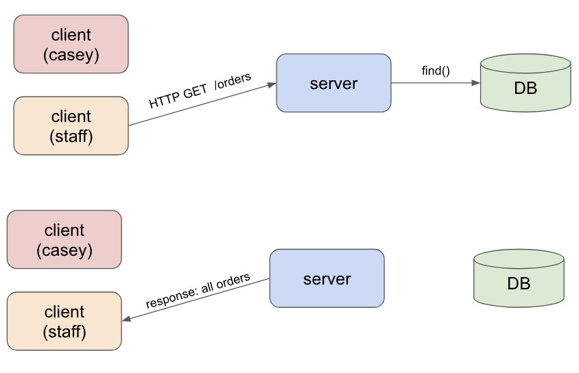

# Week 08 · Real-Time Updates with Sockets

Last week we finally connected a client to our backend, and one thing that we saw is that
changes to application data that were triggered by one client (e.g., a customer placing an
order) did not automatically result in updates to other clients (e.g., a staff user responsible for filling orders). Today we'll look at howto fix that.

## This week's goals

- Understand what sockets and WebSockets are, and how they differ from HTTP
- Learn socket.io's key ideas: events, rooms, middleware
- Push live updates from our server to the right browsers, and only the right
  ones
- Decide where in our layered server those updates should come from

## About sockets

So far this semester we've been working with one way of communicating between
hosts (i.e., computers on a network): HTTP. HTTP is built on top of other
protocols, including IP and TCP.


As we briefly discussed back in week 1, Transmission Control Protocol (TCP)
describes how two hosts communicate over a persistent connection. HTTP uses
TCP connections to send requests and get responses, and it's built around that
back-and-forth: the client asks, the server answers. Importantly, with HTTP,
**the server can't speak
first.** Usually that's fine. But sometimes it's exactly what you need: for
example, when the server should tell a client about a change it should know
about.

Back in the Aughts, the popular workaround was *long polling* (part of the AJAX
pattern): the browser sends a request, and the server deliberately holds it
open until it has something to say. It works, but it's clunky, and it has
mostly been replaced by Web Sockets.

**Web Sockets** (standardized in 2011, and supported by every modern browser)
give browsers what operating systems have long given programs, under the name
"sockets": a two-way connection that stays open. It starts as an ordinary HTTP
request that asks to be "upgraded." After that, either side can send at any
time.

**Socket.io** is a popular library built on Web Sockets, with versions for the
server and the client. It adds its own protocol on top (so a socket.io server
needs a socket.io client), plus conveniences we'll use today: named events,
rooms for sending to groups of clients, and automatic reconnection. A socket.io
server usually shares a port with the web server it's part of, and clients
connect to it by URL, like `http://localhost:6790`.

## Socket.io's key ideas

Before we wire sockets into our app, let's review the handful of ideas we'll use,
and a couple we won't use here but you might want to use in the future.

### Connections and the `socket` object

When a browser connects, the server gets a `socket` object for that one
connection: a dedicated line to that one browser. The browser has its own `socket` for
the other end. A server can have thousands of connections open at once, one
`socket` each. The client will typically have just one. Here's how each connects to the other:

::: code-group

```ts [server]
io.on('connection', (socket) => {
  console.log('someone connected', socket.id);
});
```

```ts [client]
const socket = io('http://localhost:6790');
```

:::

### Events: `emit` and `on`

Everything sent over a socket is an **event**: a name you make up, plus some
data (anything that can be turned into JSON). One side **emits** an event;
the other **listens** for it with `on`. It works like `addEventListener` for
clicks in the browser (or `onClick()` in React), except the event comes from the
other end of the network.

::: code-group

```ts [server]
// Send to this one browser.
socket.emit('order:created', order);
```

```ts [client]
// Run this whenever that event arrives.
socket.on('order:created', (order) => {
  console.log('new order', order.id);
});
```

:::

Event names are just strings. We'll name ours `resource:action`, like
`order:created`. Events can go either way, but today they'll all go from the
server to the browser.

### Broadcasting and rooms

The server can choose who hears an event:

| Code | Who hears it |
|---|---|
| `socket.emit(…)` | that one browser |
| `io.emit(…)` | every connected browser |
| `io.to('staff').emit(…)` | every browser in the `staff` room |

A **room** is a named group of sockets. The server assigns a socket (e.g., a socket
that a particular client opened) in a room
with `socket.join('staff')`. A socket can be in any number of rooms, and every
socket is automatically in a room named after its own `socket.id`. Rooms
exist only on the server: a browser can't join a room by itself, and can't
even see which rooms it's in. That's what makes them safe to use for "only
staff should hear this."

In our app we'll use a `staff` room for staff, a room per customer (`user:<their id>`)
for their own orders, and broadcasts to everyone for stock levels.

Here's a server with three browsers connected, two customers and one staff
member, each with its socket in its rooms:



(The diagrams use usernames to keep them readable. In our code the room is
named with the user's id, like `user:6ae94fd2…`.)

Sending to a user's room reaches only that user's browser:



Sending to the `staff` room reaches every staff browser:



And `io.emit` reaches everyone, whatever rooms they're in:



### Middleware and the handshake

Like Express, socket.io has middleware: `io.use(…)` runs once when a browser
connects (rather than on every request like express middlware). The middleware added via `io.use(...)` runs before `'connection'`, and can let the connection happen or turn it away. We'll use
it to check the token the browser sends when it connects.

Here's the whole connection, step by step:

![Three panels showing the browser, the client's dev server at localhost:5173, and our server at localhost:6790. First, the browser loads the client from localhost:5173. Second, a screen subscribes, and the browser asks the server to connect with an ordinary HTTP request, sending the token along. Third, the server checks the token and, if it's good, creates a socket for this browser and puts it in the right rooms (user:<id>, and staff for staff); from then on the browser and server are joined by an open socket connection](images/socket-connect.png)

### Reconnection

If a connection drops (Wi-Fi blips, the server restarts), socket.io reconnects
by itself, and listeners registered with `on` stay attached. The server,
though, sees a brand-new connection, with a new `socket.id` and no rooms. So
rooms get joined in the `'connection'` handler, which runs every time.

::: info Some things we won't use
**Namespaces** split one server into separate channels (like `/admin` and
`/chat`), each with its own events and rooms. Our app doesn't need them.

**Acknolwedgements** provide a pattern for doing request-and-response over sockets. You define callbacks on both sides--the sender provides a callback that is invoked after the receiver sends its reply. The receiver defines a callback that processes the message and invokes a provided function to trigger the response to be sent. You can [read about acknowledgments in the Socket.io docs](https://socket.io/docs/v4/emitting-events/#acknowledgements).
:::

## Clone the Starter

Accept the [Classroom 50 assignment](https://classroom50.org/SI679-Classroom-F26/si-679-f-26/assignments/week08-nyt/accept?k=mjt5rszh) and clone it to your machine.

The starter is last week's app, with the Now You Try solutions, plus a few
things we'll need today. It has the same two projects, so the same setup:

```bash
cd server
npm install
cp .env.example .env
cd ../client
npm install
cp .env.example .env
```

In `server/.env`, replace `JWT_SECRET`'s placeholder with a secret of your
own, as before.

Then the same three terminals as last week. MongoDB first (you probably don't
need `mkdir` again, but the folder given to `--dbpath` does need to exist):

```shell
# macOS / Linux
mkdir -p ~/data/mdata
mongod --dbpath ~/data/mdata
```

```shell
# Windows
mkdir c:\data\mdata
mongod --dbpath c:\data\mdata
```

The server uses a new database this week, `week8`, so seed it before starting:

```shell
cd server
npm run seed
npm run dev
```

And the client:

```shell
cd client
npm run dev
```

::: tip Reminder: restart after editing `.env`
Both projects read `.env` only when `npm run dev` starts. Not an issue now, but something to keep in mind.
:::

### What's new in the starter

```text
server/src/
├── models/user.ts                  + TokenPayload: what's inside our tokens
├── services/auth-service.ts        + verifyToken(), moved out of requireJwt
├── middleware/require-jwt.ts       now calls verifyToken()
├── sockets/sockets.ts              new, and empty for now
└── __tests__/
    ├── socket-helpers.ts           helpers for testing sockets (more later)
    └── sockets.e2e.test.ts         socket tests, waiting to be written
client/src/
├── api/socket.ts                   new, and empty for now
├── api/auth.ts                     login() and logout() call reconnectSocket()
└── components/                     the screens subscribe to live updates
```

`socket.io` (in the server) and `socket.io-client` (in the client) are
already `npm install`'ed.

**The token check moved.** Checking a token used to happen inside
`requireJwt`. Since the socket server needs the same check verifying the token becomes its own function in
the auth service, where both can use it:

::: code-group
<<< ../../../code/week08-sockets/week08-starter/server/src/services/auth-service.ts#verify{ts} [server/src/services/auth-service.ts]
:::

`requireJwt` is now "find the token, check it, and add the payload to `res.locals.user`" where other functions will expect to find it:

::: code-group
<<< ../../../code/week08-sockets/week08-starter/server/src/middleware/require-jwt.ts{ts} [server/src/middleware/require-jwt.ts]
:::

**The screens already subscribe.** Last week, each screen loaded its data
once, in a `useEffect`. Now each one also subscribes to hear about changes. Here's
My orders:

::: code-group
<<< ../../../code/week08-sockets/week08-starter/client/src/components/MyOrders.tsx#live{tsx} [client/src/components/MyOrders.tsx]
:::

`subscribe('order:updated', loadOrders)` means "whenever an `order:updated`
event arrives, run `loadOrders` again." The screen doesn't use the event's
data at all: it just reloads, with the loader it already had (`loadOrders` is provided as the callback for when the relevant event is received).

That loader, as you may recall, calls `getOrders()`, which in turn calls  `apiFetch('/orders')`, which sends an ordinary `GET /orders`. The socket doesn't carry the orders. It just says "something changed, go look."

Notice the `return`. **Whatever a `useEffect` returns, React runs when the
screen goes away** (here, when you switch to another tab of the app).
`subscribe` returns a function that stops listening, so leaving the screen
stops the listening, and coming back starts it again.

The client's staff order queue listens for two events, so it has two subscriptions
to stop:

::: code-group
<<< ../../../code/week08-sockets/week08-starter/client/src/components/OrderQueue.tsx#live{tsx} [client/src/components/OrderQueue.tsx]
:::

The Shop and Inventory do the same kind of thing with the `product:updated` event.

**But `subscribe` doesn't do anything yet.** It's in
`client/src/api/socket.ts`, and right now it just hands back a function that
does nothing:

::: code-group
<<< ../../../code/week08-sockets/week08-starter/client/src/api/socket.ts#subscribe{ts} [client/src/api/socket.ts]
:::

So this is the same deal as last week: the UI components are done and don't need to be touched. Everything we write in
the client today goes in `src/api/`.

## The problem we're going to solve

Open the app (`http://localhost:5173`) in two browser tabs, side by side. In one, log in as `casey` (password: `casey-password`) and in the other log in as `staff` (password: `staff-password`).

As Casey, place an order. Any order will do. Watch the Staff tab. Nothing. Refresh. There it is!

But this is not ideal. When business is good, lots of orders will be coming in and staff will be running around with their hands full trying to keep up (maybe). With Web Sockets we can make it so that the staff view updates every time an order is placed.

## The socket server

A new folder for the new way in and out of our app: `server/src/sockets/`.
The starter has a mostly-empty `server/src/sockets/sockets.ts`. Replace everything
above the `getIo` stub (the imports and the `initSockets` stub) with this:

::: code-group
<<< ../../../code/week08-sockets/week08-lecture/server/src/sockets/sockets.ts#setup{ts} [server/src/sockets/sockets.ts]
:::

`io` is what we're calling the socket server. It's of type `Server` which comes from the `socket.io` package. We need to set up CORS for the socket server as well--same idea as last week with different syntax. We're calling the `getClientOrigin()` utility function from last week to retrieve the client URI.

This is only the start of `initSockets`. Close it with `};` for now; we'll
add more inside it shortly.

Then, at the bottom of the file, replace the `getIo` stub with a getter that
returns the real server, for other files to use:

::: code-group
<<< ../../../code/week08-sockets/week08-lecture/server/src/sockets/sockets.ts#get-io{ts} [server/src/sockets/sockets.ts]
:::

`initSockets()` and `getIo()` are doing the same kind of thing as `connect()` and `getDb()` in `db/db.ts`: set up once at startup, used anywhere after.

### Starting everything up

Until now, `index.ts` called `app.listen()`, which quietly creates an HTTP
server for Express. Socket.io needs to share that server, so we create it
ourselves and hand it to both:

::: code-group
<<< ../../../code/week08-sockets/week08-lecture/server/src/index.ts{1,4,12,13,15 ts:line-numbers} [server/src/index.ts]
:::

The line that matters is `initSockets(server)` (line 13). Without it the
socket server never starts, and no browser can connect.

One port, one combined server. Ordinary requests go to Express; requests asking to
become a socket go to socket.io. The tests still use `app` through supertest,
so none of those have to change.

## Connecting from the browser

Now fill in `client/src/api/socket.ts`. First, add the socket itself to the
top of the file, above `subscribe`:

::: code-group
<<< ../../../code/week08-sockets/week08-lecture/client/src/api/socket.ts#connect{ts} [client/src/api/socket.ts]
:::

This is a one-stop shop for the socket on the client side. All parts of the client that use a socket will use this one. This function also handles auth for the client by providing the token on connect/reconnect.

Then rewrite `subscribe`, trading the placeholder code for what we actually need:

::: code-group
<<< ../../../code/week08-sockets/week08-lecture/client/src/api/socket.ts#subscribe{ts} [client/src/api/socket.ts]
:::

This is the function screens call from `useEffect()`.
`on` starts listening; `off` stops. The function we return (`()=> {s.off(event, handler)}`) is the one the screens hand back to `useEffect` to be called when the screen unloads.

Leave the `reconnectSocket` stub at the bottom of the file alone for now.
`auth.ts` already imports it, so deleting it leaves you with a blank page.
We'll fill it in once the server knows who's logged in.

## Who's on the other end?

Back in `server/src/sockets/sockets.ts`, we're going to add to `initSockets`. This block goes inside `initSockets()`, after the
`new Server(…)` block we wrote earlier. First, we insert some middleware that checks the token the browser sent:

::: code-group
<<< ../../../code/week08-sockets/week08-lecture/server/src/sockets/sockets.ts#auth{ts} [server/src/sockets/sockets.ts]
:::

This code handles three cases:

- **No token** (nobody's logged in in that tab): let it in. It will hear
  broadcasts, like stock changes, and nothing else.
- **A good token:** let it in, and keep what's inside the token on
  `socket.data.user`.
- **A bad token:** turn it away. The browser gets a `connect_error`.

Then, still inside `initSockets` and just below the code we just added, decide what to do with each connection that gets in:

::: code-group
<<< ../../../code/week08-sockets/week08-lecture/server/src/sockets/sockets.ts#connection{ts} [server/src/sockets/sockets.ts]
:::

Rooms are assigned based on the token, never from anything the browser asks for. A
browser can claim anything; it can't fake a token.

### Logging in changes who's connected

Reload the client. The server's terminal says `socket connected: anonymous`.
Now log in as casey, and... nothing new. The socket connected when the page
loaded, with no token, and it's still connected that way. The server still
thinks this browser is anonymous.

The fix is to reconnect when the token changes. The client's `login()`
already calls `reconnectSocket()` (it was in the starter, added to last
week's code), and `logout()` does too:

::: code-group
<<< ../../../code/week08-sockets/week08-starter/client/src/api/auth.ts#login{18,19 ts:line-numbers} [client/src/api/auth.ts]
:::

But in the starter, `reconnectSocket()` does nothing. Fill it in at the
bottom of `client/src/api/socket.ts`:

::: code-group
<<< ../../../code/week08-sockets/week08-lecture/client/src/api/socket.ts#reconnect{ts} [client/src/api/socket.ts]
:::

Disconnect and connect again: the same socket, so every screen's listeners
stay attached, but this time the `auth` function sends the new token, and the
server puts it in the new rooms.

### Try it

Reload the client (`socket connected: anonymous`), then log in as casey:
`socket connected: casey`. Log out, and it's `anonymous` again.

## The first live update

The server can now reach the right browsers. Let's tell them something.

We'll keep everything the server tells clients in one *new* file:
`server/src/sockets/notifier.ts`. The rest of the app calls its functions and
never touches socket.io directly.

::: code-group
<<< ../../../code/week08-sockets/week08-lecture/server/src/sockets/notifier.ts#order-created{ts} [server/src/sockets/notifier.ts]
:::

::: info Why `?.`
Our existing tests use supertest, which never starts a socket server, so in
those tests `getIo()` returns `null`. The `?.` stops the rest of the line from
running, because calling `.to()` on `null` would crash those tests.
:::

Call the `orderCreated` notifier function from `placeOrder`, in `server/src/services/orders-service.ts`,
right after the order is saved. Add the import at the top:

::: code-group
<<< ../../../code/week08-sockets/week08-lecture/server/src/services/orders-service.ts#imports{7 ts} [server/src/services/orders-service.ts]
:::

and add the call at the end of `placeOrder` (note that you'll need to also `await` the call to `ordersRepository.insertOrder()` and capture the result in the `order` variable to be able to hand that to the notifier):

::: code-group
<<< ../../../code/week08-sockets/week08-lecture/server/src/services/orders-service.ts#place{43,52,53,54 ts:line-numbers} [server/src/services/orders-service.ts]
:::

### Try it

The two windows again, casey and staff. casey places an order, and it appears
in the staff queue straight away. No reload.

## Where the notifier call goes

Notice where we inserted the call to the notifier. **Right after the call into the repository that committed the new order to the database.** The idea here is that we want to notify the client that something changes *if and only if it actually changes.* Anything that doesn't make it to the DB didn't happen, and we don't want to notify clients about stuff that we merely hope will happen. By calling `notifier.orderCreated()` after the successful repository operation, we know that the order was really and truly placed, and it's safe to inform anyone who is interested in (and allowed to access) that information.

Usually the call to the notifier will be in the service layer, because that's who calls into the repository. In cases where a route doesn't have a service layer and instead calls into the repository from the controller, the notifier call would go there. The rule we're following is **"Call the notifier after changing the database"**, wherever that happens.

We wouldn't call the notifier from the repository, because the decision about what is worth notifying about and to whom is more of a business logic decision than one based purely on the data. Consider also that repository functions are called by the seed script and lots of tests to create dummy data, so triggering notifications for every db write or update would trigger for those operations as well, which doesn't make a lot of sense.

Here's the full picture of what we just built, illustrating how the socket events and HTTP requests are working together. Importantly, note that the events *just* trigger a refresh of the relevant resource by the client, as opposed to conveying the data that was changed. This isn't the only way to do things, but it's simple and it works well enough for this app since the cost of fetching all orders is not meaningfully greater than fetching (or sending) just one or a few of them. You can probably imagine ways to make this more efficient if you needed to tighten things up.




## Testing sockets

How do we know our sockets are working? For example, how would we know if ONLY staff accounts got the update when a customer adds an order?

We could, say, open four browser windows--two with staff accounts and two with customer accounts--and try to keep track of which is which, but you can imagine this would get old fast. Postman does offer some support for sockets but it's a bit clunky and it doesn't really get you out of the "open a bunch of windows and keep track" game. So we need to find an automated approach using a tool like vitest.

Testing sockets needs something supertest can't give us on its own: a server
that **stays running** while test clients **stay connected**, listening for
events. supertest makes one request and it's over.

The starter includes helpers for this, in
`server/src/__tests__/socket-helpers.ts`. You don't need to change them, but
it's worth knowing what each one does:

| Helper | What it does |
|---|---|
| `startTestServer()` | starts our app, sockets and all, on a free port, and returns its address |
| `stopTestServer()` | disconnects the test clients and shuts the server down |
| `tokenFor(id, username, role)` | makes a token for a made-up user, as in week 6's tests |
| `connectAs(token?)` | connects a test client, like a browser would, with a token or none; fails if the server turns it away |
| `listenFor(client, event)` | starts listening for `event` on that client; `await` it later to get the event's data; fails the test if nothing arrives within 2 seconds |
| `heardWithin(client, event)` | waits a moment and tells you whether the client heard `event` (`true`) or not (`false`) |

All of these except `tokenFor` are `async`, so `await` them.

The last two are the new ideas. `listenFor` turns "an event will arrive at
some point" into a promise we can `await`. socket.io tells us about events
with callbacks, not promises, so `listenFor` builds its own promise with
`new Promise` and calls `resolve` when the event arrives:

::: code-group
<<< ../../../code/week08-sockets/week08-lecture/server/src/__tests__/socket-helpers.ts#listen-for{ts} [server/src/__tests__/socket-helpers.ts]
:::

`heardWithin` is for the opposite: checking that something *didn't* happen.
There's no way to wait for "never," so it waits a short while (300ms) and
reports whether the event came:

::: code-group
<<< ../../../code/week08-sockets/week08-lecture/server/src/__tests__/socket-helpers.ts#heard-within{ts} [server/src/__tests__/socket-helpers.ts]
:::

That's a trade-off worth knowing about: if an event ever took longer than
300ms to arrive, a "didn't hear it" test would pass when it shouldn't. On one
machine it's plenty.

:::tip `client.once()`
This is essentially a variant of `socket.on()` except that it only waits for ONE event, which it handles and then removes the listener. Very convenient for testing.
:::

### The test file

`server/src/__tests__/sockets.e2e.test.ts` is already set up. The database part (MongoDBMemoryServer)
is the same as our other e2e tests; the new part is `startTestServer()`, plus
a few tokens and three helpers that act over HTTP, the way the client does.
Each is named for who does it, and gives back what the server sent:
`adaPlacesOrder()` (ada orders a Braun; gives back her order),
`staffFulfills(orderId)` (staff fulfill that order) and
`staffRestocks(productId, amount)` (staff add stock):

::: code-group
<<< ../../../code/week08-sockets/week08-lecture/server/src/__tests__/sockets.e2e.test.ts#setup{ts} [server/src/__tests__/sockets.e2e.test.ts]
:::

### Our first socket test

Replace the `it.todo` under `describe('order:created')` with:

::: code-group
<<< ../../../code/week08-sockets/week08-lecture/server/src/__tests__/sockets.e2e.test.ts#created-test{ts} [server/src/__tests__/sockets.e2e.test.ts]
:::

What's happening, step by step:

1. Connect two test clients: one as staff, one as a customer.
2. **Start listening before doing anything.** `listenFor` and `heardWithin`
   return promises right away, without `await`; we only `await` them at the
   end. If we placed the order first and started listening after, the event
   could arrive before anyone was listening, and the test would miss it.
3. Place the order over HTTP, exactly as the client does.
4. Staff should hear `order:created`, with the order that was just placed;
   the customer shouldn't hear it at all.

Run `npm test`: the new test passes, and the four `it.todo`s left in the file
are yours.

::: tip Does it really catch anything?
Try breaking it. Comment out the `notifier.orderCreated(order)` line in
`placeOrder`, and the test fails with `No order:created within 2000ms`. Change
the notifier to `getIo()?.emit(…)` (everyone, not just staff), and it fails
because the customer heard it. Put both back.
:::

:::info Announcements

- Final IPA signups available (see Canvas Assignment)
- HW4 out ~~today~~ tomorrow (may need to push release to Thursday)! Due Nov 23 (2 weeks from now)
- Final project proposals - feedback has been returned
- Final project Checkpoint #1 due Nov 16 (1 week from now)
- Nov 24 will be Final Project Hacker Jam - come work on your project, get help/advice/feedback, make the magic happen
- Dec 1 is TBD
- Dec 8 is Demo Day (final presentations and demos)

## Now You Try

::: tip Lost? Catch up here
Copy these from the
[finished lecture code](https://github.com/SI679-public/SI679-public.github.io/tree/main/code/week08-sockets/week08-lecture)
into your project, replacing yours:
`server/src/sockets/sockets.ts`, `server/src/sockets/notifier.ts`,
`server/src/index.ts`, `server/src/services/orders-service.ts`,
`server/src/__tests__/sockets.e2e.test.ts` and `client/src/api/socket.ts`.
:::

Your job: **make the rest of the screens live, and implement socket tests for the server.**
Everything here happens on the server: the client's screens are already listening.

**1. Order updates.** When staff fulfill an order, the customer who placed it
and every staff browser should hear `order:updated`.

- Add `orderUpdated(order)` to `server/src/sockets/notifier.ts`. You can send
  to two rooms at once: `.to(…).to(…).emit(…)`. The order knows its
  customer's id, so use that to compose the room identifier (`` `user:${order.customerId}` ``).
- Call it from `fulfillOrder` in `server/src/services/orders-service.ts`, right
  after the change is saved.

**2. Stock updates.** Whenever a product's stock changes, *everyone* should
hear `product:updated`, logged in or not, with the product's id.

- Add `productUpdated(productId: string)` to the notifier. It sends just the
  id; the screens reload the product list themselves.
- Find every place stock changes, and call it right after each one. (Hint:
  there are two, in two different services.)
- Make sure you `await` the change before you notify. Without the `await`,
  the event goes out before the stock is saved, and the screens can reload
  the old number.

**3. Socket tests.** Fill in the four `it.todo`s in
`server/src/__tests__/sockets.e2e.test.ts`. The `order:created` test from
lecture is your model: connect, start listening, do something over HTTP,
then check what each client heard.

- `'turns away a bad token'`: connect with a made-up token. `connectAs`
  rejects when the server turns a client away, so
  `await expect(connectAs(…)).rejects.toThrow(…)`, with the message from
  `io.use`.
- `'reaches the customer who placed the order, and no other customer'`:
  place an order as ada with `adaPlacesOrder()`, connect ada and bo, start
  listening on both, then fulfill it with `staffFulfills()`. It needs the id
  of the order to fulfill, and `adaPlacesOrder()` gives you back ada's order:
  `const placed = await adaPlacesOrder();`, then `staffFulfills(placed.id)`. ada
  should hear it, with status `fulfilled`; bo shouldn't.
- The two `product:updated` tests: connect a client **with no token**, then
  place an order (or restock with `staffRestocks(braun.id, 5)`). It should
  hear `product:updated` with `braun.id`.

**Stretch.** Write a *unit* test that verifies that `placeOrder` calls
`notifier.orderCreated` once, with the saved order, and doesn't call it when
there isn't enough stock. Mock the repositories and spy on the notifier, as in
week 5.

### You're done when...

- `npm test` passes in `server/`, with no `it.todo`s left in
  `sockets.e2e.test.ts`.
- casey's **My orders** flips to **Fulfilled** the moment staff fulfill her
  order, with no reload.
- With two staff windows open, fulfilling in one moves the order in the other.
- Placing an order or restocking updates the stock in every window,
  including one where nobody's logged in.

Lecture code with Now You Try solutions can be found
[on GitHub](https://github.com/SI679-public/SI679-public.github.io/tree/main/code/week08-sockets/week08-nyt-solution).
